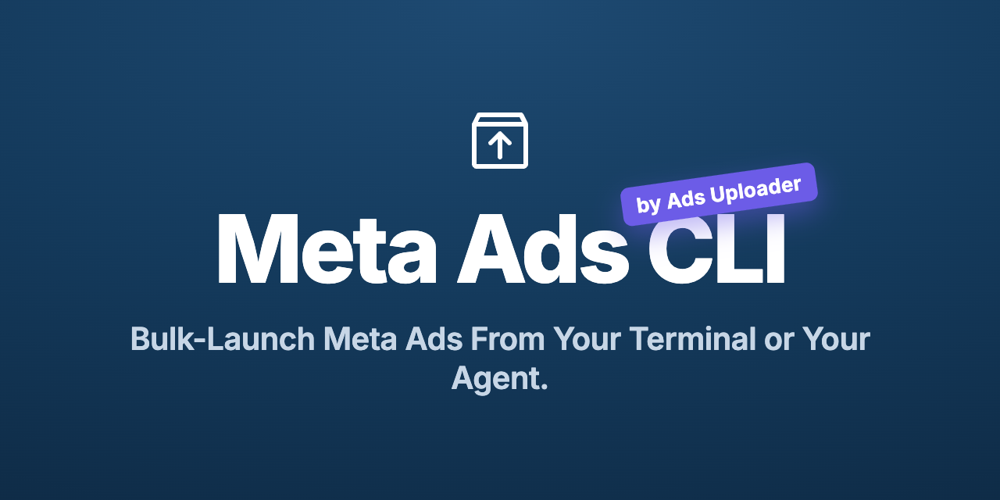

<p align="center">
  
</p>

<h1 align="center">Ads Uploader: Meta Ads CLI</h1>

<p align="center">The <strong>Meta Ads CLI</strong> by Ads Uploader lets you analyze, edit and launch Meta (Facebook &amp; Instagram) ads from your terminal or an AI agent, using the same launch engine as the web app.</p>

<p align="center">
  <a href="https://www.npmjs.com/package/@adsuploader/cli"></a>
  <a href="https://adsuploader.com/meta-ads-cli"></a>
  
  <a href="https://github.com/adsuploader/meta-ads-cli/stargazers"></a>
</p>

---

The `ads` CLI reads performance, changes live campaigns and launches new ads in bulk, from your terminal, a script or an AI coding agent. It follows the same per-account agent permissions as the [Meta Ads MCP server](https://github.com/adsuploader/meta-ads-mcp), so changes on accounts set to Approval wait in the **Agent Inbox** until a person approves them.

> **Preview first.** `ads create:preview` and every `ads edit:*` command show exactly what would change before anything is created or edited.

## What it does

- **Analyze.** Query Meta Ads Insights, check campaign health, read account status and spend, see Meta's change history, estimate delivery, and list audiences, conversions, library media and posts.
- **Edit live campaigns.** Status, budgets, spend caps, bids, schedules, targeting, ad set settings, ad creative text and links, renames, archives and deletes, all with a preview first. Reversible edits can be undone.
- **Launch in bulk.** Copy the settings of an ad you already run, then build new ads on top of it with new media, copy, CTA and targeting, across many campaigns and ad sets in one command.
- **Duplicate.** Copy campaigns, ad sets or ads by ID, or duplicate ads by Page post ID so likes, comments and shares carry over.
- **Agent Inbox and History.** Approval-gated launches, copies and edits wait in the Agent Inbox. `ads history` shows every launch and edit from the web app, MCP, CLI and API.

## Why Ads Uploader

Built on a decade of hands-on Meta advertising, Ads Uploader gives you the Meta (Facebook &amp; Instagram) workflows media buyers already rely on:

- **Template from any live ad.** Copy a proven ad's exact settings, then rebuild on top with new media, copy and targeting.
- **Real bulk.** Many ads across campaigns and ad sets in a single command, with per-ad and per-ad-set text.
- **The same engine as the web app.** The CLI creates exactly what the Ads Uploader uploader would.
- **Every format the web app supports.** Carousels, flexible ads, Multi Media ads, partnership ads, Product Showcase, creative enhancements and Advantage+ targeting.
- **Control you choose.** Per-account Agent Launch and Agent Edit permissions (Off, Approval or Allowed), previews, saved builds you can finish in the web app, and a full History.

Built by a team that runs Meta ads at scale, and used by performance marketers and agencies managing serious Meta budgets.

## Install

```bash
npm install -g @adsuploader/cli
ads login
```

Requires Node.js 18 or later. `ads login` signs you in through your browser, with no token copying. On a server without a browser, use `ads login --device`. For scripts and scheduled agents, create an API key under **Account > MCP, CLI & API** and set `ADS_API_KEY`.

## Quick start

```bash
ads accounts                     # list your ad accounts
ads account act_123456           # set the default account
ads insights:health --campaign <id> --preset last_30d   # how is this campaign doing?
ads upload hero.jpg https://cdn.example.com/video.mp4   # local files and public URLs
ads upload:drive "https://drive.google.com/drive/folders/..."   # a whole Drive folder
ads create:preview spec.json     # dry run: see exactly what would be created
ads create spec.json             # create the ads
```

A spec is a small JSON file describing what to build: the media, the copy, the CTA, targeting, and which existing ad to template from. See the [full spec reference](https://adsuploader.com/docs/automation/cli).

## Commands

**Accounts and reads**

| Command | What it does |
| --- | --- |
| `ads login` · `ads login --device` · `ads login --api-key` | Sign in through the browser, another device, or an API key |
| `ads accounts` · `ads account <id>` · `ads account:info <id>` | List ad accounts, set the default, or read status, currency, timezone, spend and funding |
| `ads campaigns` · `ads campaign <id>` · `ads adsets` · `ads adset <id>` · `ads ads` · `ads ad <id>` | Browse campaigns, ad sets, ads and creatives |
| `ads pages` · `ads posts --page <id>` | Facebook Pages, connected Instagram accounts and their posts |
| `ads audiences` · `ads conversions` | Audiences, pixels and conversions |
| `ads library:images` · `ads library:videos` | Media in the ad account library |
| `ads targeting:search <query>` | Find Meta targeting keys |

**Analyze**

| Command | What it does |
| --- | --- |
| `ads insights` · `ads insights:fields` · `ads insights:job <id>` | Query Meta Ads Insights and page async reports |
| `ads insights:health --campaign <id>` | Campaign performance, results, budget, issues and learning status |
| `ads estimate --targeting targeting.json` | Predicted audience size and delivery curve |
| `ads meta-activity --since <date>` | Meta's change history, including edits in Ads Manager |

**Edit**

| Command | What it does |
| --- | --- |
| `ads edit:status` · `edit:budget` · `edit:spend-cap` · `edit:spend-limits` · `edit:bid` · `edit:schedule` | Change delivery, budgets, caps, bids and schedules |
| `ads edit:targeting` · `edit:adset-settings` | Change ad set audiences and settings |
| `ads edit:creative <ad-id>` | Change an ad's primary text, headline, description, CTA, link or URL tags |
| `ads edit:rename` · `edit:archive` · `edit:delete` | Rename, archive or delete campaigns, ad sets and ads |
| `ads edits` · `ads edits cancel <reviewId>` | List edits, or cancel suggestions still waiting for approval |

**Launch and duplicate**

| Command | What it does |
| --- | --- |
| `ads upload <inputs…>` · `ads upload:drive <url>` · `ads uploads` | Upload media from files, URLs or Drive, and list batches |
| `ads create spec.json` · `ads create:preview` · `ads create:interactive` | Create ads, dry-run, or use the guided wizard |
| `ads duplicator:copy` · `ads duplicator:copy:preview` | Copy campaigns, ad sets or ads by ID |
| `ads duplicator:post-id` · `ads duplicator:post-id:preview` | Duplicate ads by Page post ID, keeping social proof |
| `ads presets` · `ads presets:save` | Reusable API and text presets |
| `ads builds` · `builds:create` · `builds:update` · `builds:fork` · `builds:delete` | Saved builds you can review and launch in the web app |
| `ads launch:discard <id>` | Discard a launch waiting in your Agent Inbox |
| `ads jobs <id>` · `ads duplicator:status <jobId>` | Check a background job |

**History**

| Command | What it does |
| --- | --- |
| `ads history` · `ads history launch <launchId>` | Every Ads Uploader launch and change, from the web app, MCP, CLI and API |
| `ads inbox:history` | What was approved, changed or discarded in the Agent Inbox |

Most commands support `--json` for scripts and agents. Full reference: [adsuploader.com/docs/automation/cli](https://adsuploader.com/docs/automation/cli).

## Agent permissions and the Agent Inbox

Each ad account has its own **Agent Launch** and **Agent Edit** setting in the Ads Uploader web app: Off, Approval or Allowed. On **Approval**, `ads create`, `ads duplicator:*` and `ads edit:*` send their changes to the Agent Inbox, and nothing reaches Meta until a person approves them. On **Allowed**, they run straight away. Add `--reason` and `--run-title` to edits and copies so reviewers see why each change was proposed.

## Drive it from an AI agent

The package ships a `SKILL.md` describing every command and option for coding agents (Claude Code, Cursor, Codex). Point your agent at `node_modules/@adsuploader/cli/SKILL.md`, then ask in plain language:

- *"Which ad sets in my Sales campaign spent the most last week without a purchase? Pause them."*
- *"Raise the daily budget by 20% on any ad set with a CPA under $30 over the last 7 days, with a reason for each change."*
- *"Using any ad from my Sales ad set as the template, launch these 100 creatives, with a unique headline and primary text for each."*
- *"Duplicate the ad behind this Facebook post into my Retargeting ad set so the likes and comments carry over."*
- *"Assemble a build from these creatives and copy, then give me the link to review and launch it in the web app."*

## Partnership (branded content) ads

The CLI launches partnership ads two ways: your **own uploaded media** as a Facebook or Instagram partnership, or an **imported Instagram creator post**. Add `profile.partnership` to a spec, with shared or per-ad and per-ad-set sponsors and a launch-wide header mode. `ads create:preview` reports each ad's effective sponsor and checks authorization before anything is created. Facebook post imports and Threads on imported posts aren't supported. Full field reference: [`SKILL.md`](./SKILL.md) and the [docs](https://adsuploader.com/docs/automation/cli).

## Hand off to the web app

Instead of launching headlessly, assemble a **saved build** and finish it in the UI you know:

```bash
ads builds:create --account act_123 --name "Agent draft" --spec spec.json
# Open the printed web URL, review, and press Create Ads.
```

The build opens in the Ads Uploader web uploader, so you keep a human review-and-launch step.

## Learn more

- **Docs:** [CLI](https://adsuploader.com/docs/automation/cli) · [Edits and the Agent Inbox](https://adsuploader.com/docs/automation/edits) · [Insights](https://adsuploader.com/docs/automation/insights)
- **Website:** [CLI for Meta Ads](https://adsuploader.com/meta-ads-cli) · [MCP for Meta Ads](https://adsuploader.com/mcp-meta-ads)
- **Security:** [SECURITY.md](./SECURITY.md) · **Privacy:** [PRIVACY.md](./PRIVACY.md)

## Support

Questions or issues: **support@adsuploader.com**

## License

© Pingzu Digital LLC. All rights reserved. The hosted service and packages are proprietary; this repository contains connector documentation and configuration.
